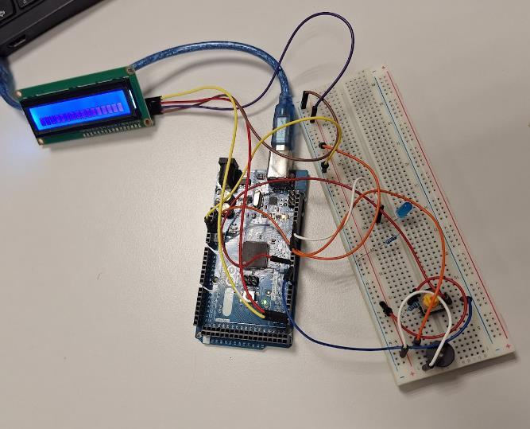

# Arduino Morse Code Translator

A Morse code device built with an Arduino. Tap out Morse code on a single button and the message appears on an LCD screen. Or type text on your computer and hear it played back as Morse on a buzzer, with an LED that flashes along.

The original project name is *Morseapparat*, which is Norwegian for "Morse apparatus".



## What it does

- **Button → text:** one button registers short and long presses (dot and dash) using interrupts and `millis()`. The code recognises all 26 letters and the digits 0–9, and shows the message on the LCD and in the Serial Monitor.
- **Text → Morse:** type a message in the Serial Monitor and the device plays it as beeps on the buzzer, with an LED blinking in time.
- **LCD output:** the translated message is shown on a 16×2 I2C display.

Not implemented: communication between two devices (wire, IR or Bluetooth), which was the optional last part of the assignment.

## Hardware

- Arduino Mega 2560 (any board with interrupts on pins 2 and 3 should work)
- 16×2 LCD with I2C backpack (address `0x27`)
- Push button
- Buzzer
- LED with a resistor
- Breadboard and jumper wires

### Wiring

| Part | Arduino pin | Notes |
|---|---|---|
| Button (press detection) | D2 | Interrupt on RISING |
| Button (release detection) | D3 | Interrupt on FALLING; wired to the **same** button as D2 |
| Buzzer | D8 | |
| LED | D11 | Use a resistor in series |
| LCD SDA / SCL | SDA / SCL pins | On the Mega: 20 and 21 |
| LCD VCC / GND | 5V / GND | |

The pins are set up as plain inputs and the code expects them to go HIGH when the button is pressed, so the button needs a pull-down resistor.

## Setup

1. Install the [Arduino IDE](https://www.arduino.cc/en/software).
2. Install the **LiquidCrystal I2C** library (Sketch → Include Library → Manage Libraries, for example the one by Frank de Brabander). `Wire` is included with the IDE.
3. Open `morse_apparatus/morse_apparatus.ino`.
4. Choose your board and port, then click **Upload**.
5. Open the Serial Monitor at **9600 baud**.

## How to use it

### Button → text

| Hold the button for | What happens |
|---|---|
| up to 0.4 s | Dot (`.`) |
| 0.4 – 2 s | Dash (`-`) |
| 2 – 5 s | Letter finished: the dots and dashes so far are translated and added to the word |
| more than 5 s | The pending letter is translated and the **whole word** is shown on the LCD and Serial Monitor |

Example: to write `SOS`, press `· · ·` and hold 2–5 s, then `− − −` and hold 2–5 s, then `· · ·` and hold more than 5 s.

### Text → Morse

Type **uppercase** letters and digits in the Serial Monitor and press Send. The buzzer and LED play the message.

## How it works

Two interrupts watch the same button. `push()` stores the time of the press (RISING) and `realese()` stores the time of the release (FALLING), both with a debounce delay. In `loop()` the difference is the hold time, which decides between dot, dash, end of letter and print. Morse codes are looked up in a `morse[]` array that lines up index by index with `alfabet[]`. Typed text goes the other way: each character is looked up in `alfabet[]` and played using the matching `morse[]` entry.

## Limitations

- Typed text must be uppercase letters and digits. Spaces are skipped.
- The text-to-Morse buffer is never cleared, so a second message replays the first one before the new one. Reset the board to start over.
- A Morse sequence that doesn't match any character stays in the buffer. Reset the board to clear it.
- The more-than-5-second press only displays the word if there is a letter still pending. End a word with that press, instead of confirming the last letter first.

## Project structure

```
.
├── morse_apparatus/
│   └── morse_apparatus.ino   # the Arduino sketch
├── images/
│   └── setup.jpg             # photo of the build
├── README.md
├── LICENSE
└── .gitignore
```

## License

MIT. See the [LICENSE](LICENSE) file.
